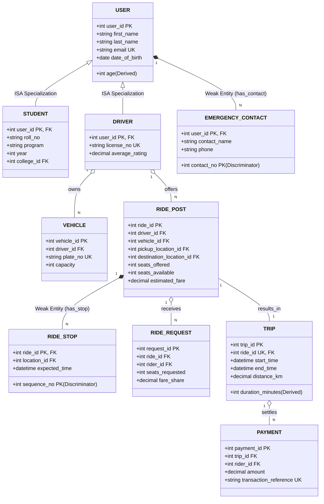

# CampusPool — DBMS Concepts & Viva Examination Study Guide
**Textbook Reference**: *Database System Concepts*, 5th/6th/7th Ed. (Silberschatz, Korth, Sudarshan — Chapters 3 & 4)  
**ER Diagram Reference**: [`docs/rideshare.pdf`](docs/rideshare.pdf)  
**Target Database**: MySQL 8.0+

---

## 🏛️ Section 1: ER Diagram & Relational Schema Mapping

The database schema directly maps the entities, relationships, attributes, and constraints depicted in the canonical ER Diagram ([`docs/rideshare.pdf`](docs/rideshare.pdf)):

### 1.1 Decomposition of Attributes (1NF)
1. **Composite Attribute Decomposition**:
   - In the ER diagram, the entity `USER` contains the composite attribute `name`.
   - **Resolution**: Decomposed into atomic attributes `first_name` and `last_name` in table `USER` (satisfies 1NF atomicity rule).
2. **Multivalued Attribute Decomposition**:
   - In the ER diagram, `USER` has a multivalued attribute `phone_numbers` (multiple mobile numbers).
   - **Resolution**: Decomposed into child relation `USER_PHONE(user_id, phone_no, is_primary)` with composite primary key `(user_id, phone_no)` (eliminates repeating groups, strictly 1NF).
3. **Derived Attributes**:
   - `USER.age`: Derived from `date_of_birth` using `TIMESTAMPDIFF(YEAR, date_of_birth, CURDATE())` (maintained dynamically via reactive triggers to eliminate update anomalies).
   - `TRIP.duration_minutes`: Derived from `TIMESTAMPDIFF(MINUTE, start_time, end_time)` via a MySQL `VIRTUAL GENERATED COLUMN`.

### 1.2 Weak Entities & Identifying Relationships
1. **`EMERGENCY_CONTACT`** (Weak entity of `USER`):
   - **Owner Entity**: `USER`
   - **Discriminator / Partial Key**: `contact_no`
   - **Composite Primary Key**: `(user_id, contact_no)`
   - **Referential Integrity**: `FOREIGN KEY (user_id) REFERENCES USER(user_id) ON DELETE CASCADE`.
2. **`RIDE_STOP`** (Weak entity of `RIDE_POST`):
   - **Owner Entity**: `RIDE_POST`
   - **Discriminator / Partial Key**: `sequence_no`
   - **Composite Primary Key**: `(ride_id, sequence_no)`
   - **Referential Integrity**: `FOREIGN KEY (ride_id) REFERENCES RIDE_POST(ride_id) ON DELETE CASCADE`.

### 1.3 ISA Specialization Hierarchy
- `USER` is the generalized superclass entity.
- `STUDENT` and `DRIVER` are specialized subclasses.
- **Relational Representation**:
  - `STUDENT` has primary key `user_id`, which is simultaneously a foreign key referencing `USER(user_id)`.
  - `DRIVER` has primary key `user_id`, which is simultaneously a foreign key referencing `USER(user_id)`.
  - Prevents `NULL` clutter: Student roll numbers only exist in `STUDENT`; driving licenses and driver ratings only exist in `DRIVER`.

---

## 📐 Section 2: Normalization Formal Proof (1NF to 3NF & BCNF)

| Relation | Primary Key | Candidate Keys | 1NF? | 2NF? | 3NF? | BCNF? | Normalization Rationale |
| :--- | :--- | :--- | :---: | :---: | :---: | :---: | :--- |
| **COLLEGE** | `college_id` | `college_id` | Yes | Yes | Yes | Yes | All attributes depend solely on `college_id`. No transitive dependencies. |
| **COMMUNITY** | `community_id` | `community_id` | Yes | Yes | Yes | Yes | Determinant `community_id` is a candidate key. |
| **USER** | `user_id` | `user_id`, `email` | Yes | Yes | Yes | Yes | Atomic domains. `email` is alternate candidate key. No non-prime transitive dependencies. |
| **COMMUNITY_MEMBER**| `(user_id, community_id)` | `(user_id, community_id)` | Yes | Yes | Yes | Yes | Intersection table resolving M:N relationship. Full dependency on composite key. |
| **USER_PHONE** | `(user_id, phone_no)` | `(user_id, phone_no)` | Yes | Yes | Yes | Yes | Resolves multivalued `phone_numbers`. No partial key dependencies. |
| **STUDENT** | `user_id` | `user_id` | Yes | Yes | Yes | Yes | ISA specialization. `user_id -> roll_no, program, year, college_id`. |
| **DRIVER** | `user_id` | `user_id`, `license_no` | Yes | Yes | Yes | Yes | Determinants `user_id` and `license_no` are both superkeys. |
| **EMERGENCY_CONTACT**| `(user_id, contact_no)` | `(user_id, contact_no)` | Yes | Yes | Yes | Yes | Weak entity. Non-prime attributes depend fully on composite PK. |
| **VEHICLE** | `vehicle_id` | `vehicle_id`, `plate_no` | Yes | Yes | Yes | Yes | Determinants are superkeys. |
| **LOCATION** | `location_id` | `location_id` | Yes | Yes | Yes | Yes | Normalized address catalog. Eliminates string redundancy. |
| **RIDE_POST** | `ride_id` | `ride_id` | Yes | Yes | Yes | Yes | All route endpoints and seat quotas depend directly on `ride_id`. |
| **RIDE_STOP** | `(ride_id, sequence_no)`| `(ride_id, sequence_no)`| Yes | Yes | Yes | Yes | Weak entity with full functional dependency on composite key. |
| **RIDE_REQUEST** | `request_id` | `request_id` | Yes | Yes | Yes | Yes | Unique request identifier; no transitive dependencies. |
| **TRIP** | `trip_id` | `trip_id`, `ride_id` | Yes | Yes | Yes | Yes | 1:1 execution entity with candidate key `ride_id`. |
| **PAYMENT** | `payment_id` | `payment_id`, `transaction_reference` | Yes | Yes | Yes | Yes | Financial settlement table with unique bank reference. |
| **RATING** | `rating_id` | `rating_id` | Yes | Yes | Yes | Yes | Mutual peer feedback table. |
| **NOTIFICATION** | `notification_id` | `notification_id` | Yes | Yes | Yes | Yes | Push notification event table. |
| **AUDIT_LOG** | `log_id` | `log_id` | Yes | Yes | Yes | Yes | Append-only system audit log. |

---

## 📚 Section 3: Mapping to Textbook Slides (Silberschatz Ch. 3 & 4)

| Slide / Concept (Silberschatz) | SQL Topic | Script in CampusPool | Viva Demonstration Query / Procedure |
| :--- | :--- | :--- | :--- |
| **Slide 3.6 - 3.8** | `CREATE TABLE`, `DROP`, `ALTER` | `01_schema_tables.sql` | Table definitions, foreign key cascade rules |
| **Slide 3.9 - 3.12** | Basic Query, `DISTINCT`, Arithmetic | `99_test_queries.sql` (Query 1) | `SELECT DISTINCT estimated_fare * 1.05` |
| **Slide 3.13 - 3.14** | `WHERE` clause with `BETWEEN` | `99_test_queries.sql` (Query 2) | `WHERE estimated_fare BETWEEN 40 AND 120` |
| **Slide 3.16 - 3.17** | Renaming `AS` & Tuple Variables | `99_test_queries.sql` (Query 1, 13D)| `FROM STUDENT s1 JOIN STUDENT s2` |
| **Slide 3.18** | String Operations (`LIKE`) | `99_test_queries.sql` (Query 3) | `WHERE email LIKE '%@coep.%'` |
| **Slide 3.19** | Ordering Display (`ORDER BY DESC/ASC`)| `99_test_queries.sql` (Query 2) | `ORDER BY estimated_fare DESC` |
| **Slide 3.22 - 3.23** | Set Operations (`UNION`, `UNION ALL`) | `99_test_queries.sql` (Query 4) | Seed data volume aggregate report |
| **Slide 3.24 - 3.25** | Aggregates (`AVG`, `SUM`, `COUNT`, `MIN`, `MAX`)| `99_test_queries.sql` (Query 5) | Trip statistics calculation |
| **Slide 3.26 - 3.27** | `GROUP BY` and `HAVING` clause | `99_test_queries.sql` (Query 6) | Driver distance grouped with `HAVING total_km > 10` |
| **Slide 3.28 - 3.30** | `NULL` Values & 3-Valued Logic | `01_schema_tables.sql`, `99_test_queries.sql` | `IS NULL` on completed trip timestamps |
| **Slide 3.31 - 3.33** | Nested Subqueries (`IN`, `NOT IN`)| `99_test_queries.sql` (Query 8) | `WHERE user_id IN (SELECT driver_id FROM VEHICLE)` |
| **Slide 3.34 - 3.37** | Set Comparisons (`> ALL`, `> SOME`)| `99_test_queries.sql` (Query 9) | `WHERE estimated_fare > ALL (...)` |
| **Slide 3.38 - 3.39** | Empty Relations (`EXISTS`, `NOT EXISTS`)| `99_test_queries.sql` (Query 10A, 10B)| Active riders with pending requests |
| **Slide 3.42** | Derived Relations (`FROM (SELECT ...)`)| `99_test_queries.sql` (Query 11) | Subquery inside `FROM` clause |
| **Slide 3.43 - 3.44** | `WITH` Clause (Common Table Expressions)| `99_test_queries.sql` (Query 12) | CTE for route popularity + Recursive CTE for stops |
| **Slide 3.45 - 3.49** | Database Views (`CREATE VIEW AS`)| `04_views.sql`, `99_test_queries.sql` (Query 15)| `vw_masked_users`, `vw_available_rides` |
| **Slide 3.50 - 3.55** | DML: `INSERT`, `UPDATE` with `CASE`, `DELETE`| `06_stored_procedures.sql` | `INSERT INTO ... SELECT`, conditional `CASE` status updates |
| **Slide 3.56 - 3.57** | Updatable Views | `04_views.sql` | `vw_updatable_emergency_contact` |
| **Slide 3.58 - 3.62** | Joins (`INNER`, `LEFT`, `RIGHT`, `SELF`)| `99_test_queries.sql` (Query 13A - 13D)| Multi-table joins across 5 tables |
| **Slide 4.8 - 4.13** | Domain & Integrity Constraints (`CHECK`)| `02_constraints_indexes.sql` | `CHECK (seats_available <= seats_offered)` |
| **Slide 4.14 - 4.16** | Referential Integrity & Foreign Keys | `01_schema_tables.sql` | `ON DELETE CASCADE / SET NULL / RESTRICT` |
| **Slide 4.20 - 4.23** | Authorization, Roles, `GRANT`, `REVOKE`| `10_security_roles.sql` | `app_role`, `GRANT EXECUTE`, `REVOKE DELETE` |
| **Advanced Ch. 4** | ACID Transactions & Pessimistic Locks | `06_stored_procedures.sql`, `08_transactions_demo.sql`| `START TRANSACTION`, `SELECT ... FOR UPDATE`, `SAVEPOINT` |
| **Advanced Ch. 4** | Procedural Cursors & Background Events | `09_events_cursors.sql` | `DECLARE cur CURSOR FOR ... FETCH ...`, MySQL Event |

---

## 🎯 Section 4: Quick Viva Cheatsheet (Top Examiner Questions)

### Q1: Why did you decompose `name` and `phone_numbers` in `USER`?
> **Answer**: `name` is a composite attribute (made of first name and last name), and `phone_numbers` is a multivalued attribute. Storing them in a single column violates **First Normal Form (1NF)** atomicity. We resolved this by decomposing `name` into `first_name` and `last_name`, and decomposing `phone_numbers` into the relation `USER_PHONE(user_id, phone_no)`.

### Q2: What is the difference between a Strong Entity and a Weak Entity in your project?
> **Answer**: A strong entity has an independent primary key (e.g., `USER` with `user_id`). A weak entity cannot be uniquely identified by its own attributes alone and depends on an owner entity via an identifying relationship. In CampusPool:
> - `EMERGENCY_CONTACT` is a weak entity dependent on `USER` with discriminator `contact_no` (composite PK: `user_id, contact_no`).
> - `RIDE_STOP` is a weak entity dependent on `RIDE_POST` with discriminator `sequence_no` (composite PK: `ride_id, sequence_no`).

### Q3: How did you implement Specialization (ISA)?
> **Answer**: `USER` is the generalized superclass. `STUDENT` and `DRIVER` are specialized subclasses. Each child table has `user_id` as both its Primary Key and a Foreign Key referencing `USER(user_id)`. This keeps student attributes (roll number, academic year) and driver attributes (license number, ratings) cleanly partitioned.

### Q4: How does your database prevent seat overbooking during simultaneous requests?
> **Answer**: We use **Pessimistic Concurrency Control** inside stored procedure `sp_accept_request` using `SELECT seats_available FROM RIDE_POST WHERE ride_id = ? FOR UPDATE;`. This places an exclusive write lock on the ride row so no concurrent transaction can read or decrement the seat inventory until the active transaction commits.

### Q5: How do your triggers enforce database integrity?
> **Answer**:
> - `trg_prevent_driver_self_request` blocks drivers from booking seats on their own rides (`SIGNAL SQLSTATE '45000'`).
> - `trg_prevent_overbooking` ensures requested seats do not exceed available seats.
> - `trg_restore_seats_on_cancel` automatically restores seats back to the ride if a passenger cancels.
> - `trg_update_driver_rating_after_insert` automatically recomputes driver ratings whenever a review is posted.
